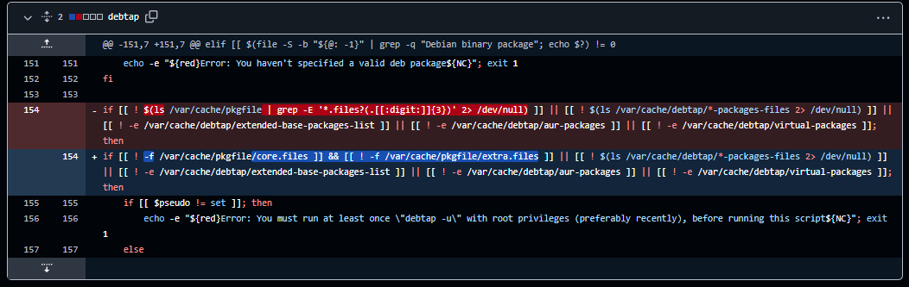

# debtap

A script for converting Debian `.deb` packages into Arch Linux packages, with a focus on accurate package metadata.

## Usage

```bash
debtap -o output_directory [other_options] package_filename
```

Run `debtap --help` for the available options.

## Changes


- **Cache-check fix:** replaced the malformed `ls | grep` wildcard check with a direct check for `/var/cache/pkgfile/core.files` and `/var/cache/pkgfile/extra.files`. The old pattern escaped `*`, so it could be treated as a literal character and fail to detect cache files.
- **Optional C++ port since you don't have time:** `main.cpp` is provided as an alternative implementation for maintainers who may find it useful or prefer not to spend time doing the port themselves.
The C++ port is experimental and is not yet feature-complete; the original `-u` database-update workflow and full automatic package-name database translation are not implemented. Build it on Linux/Arch Linux with:

### Fix temporary files ending up in packages (#110)

Remove the temporary `namcap-*` analysis files before generating `.MTREE` and the final package archive. This prevents leftover analysis files from being accidentally included in converted packages when the dependency-processing branch is skipped.

Testing:
- `bash -n debtap`
- `git diff --check`
- Tested conversion of a package without `Depends` or `Pre-Depends`, and checked the generated archive for leftover temporary files.

```bash
g++ -std=c++17 -O2 -Wall -Wextra -pedantic main.cpp -o debtap-cpp
```

Required tools can be installed on Arch Linux with `sudo pacman -S --needed base-devel libarchive tar zstd`.
